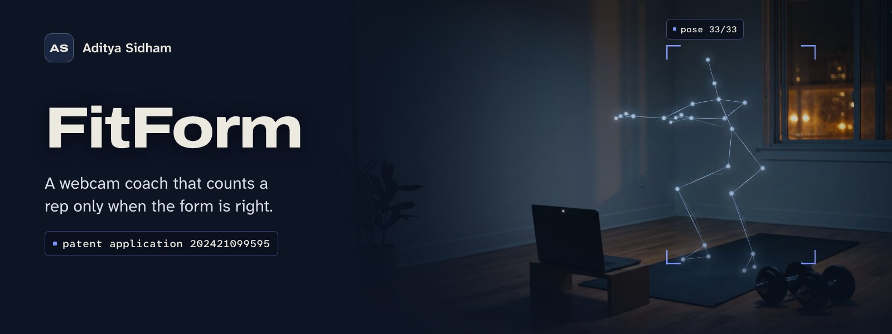
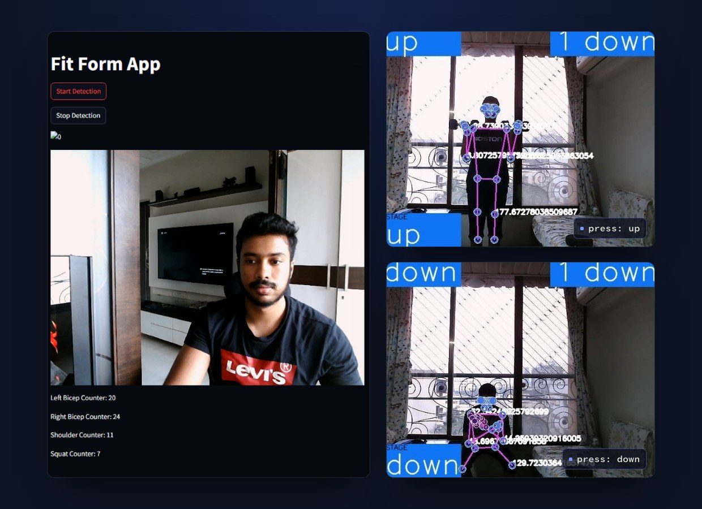
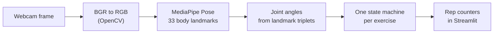

<a id="readme-top"></a>

<div align="center">

<a href="https://adityasidham.site/FitForm.html"></a>

<br>


**[Case study](https://adityasidham.site/FitForm.html)** &nbsp;|&nbsp; **[See it](#see-it)** &nbsp;|&nbsp; **[How it works](#how-it-works)** &nbsp;|&nbsp; **[Run it](#run-it)** &nbsp;|&nbsp; **[Patent](#patent-application)**

</div>

<br>

A rep counter can tell you how much you moved, but not whether the movement was any good. **FitForm watches you through an ordinary webcam, measures your joints every frame, and only counts a rep when it goes through the full range of motion.** A half squat or a swinging curl doesn't add to the number.

This repository is the first working prototype, built in November 2023: a Streamlit app that counts bicep curls on each arm, shoulder presses and squats in real time. The work became a published Indian patent application with me as a co-applicant.

## See it

<p align="center">
  
</p>

<p align="center"><sub>The prototype app with live counters, and pose tracking through a shoulder press.</sub></p>

## How it works



1. **Pose.** MediaPipe Pose finds 33 body landmarks in each frame, at a minimum detection and tracking confidence of 0.5.
2. **Angles.** For each exercise, three landmarks make a joint angle, computed with `arctan2` and folded into 0 to 180 degrees.
3. **State machines.** Each exercise has a "down" and an "up" threshold. A rep only counts on a full cycle, so partial movements never register.

| Exercise | Angle | Counts a rep when |
|---|---|---|
| Bicep curl, left and right | shoulder, elbow, wrist | the arm opens past 160° and then closes under 30° |
| Shoulder press | hip, shoulder, elbow | the arm drops to 109° or less and then rises past 169° |
| Squat | hip, knee, ankle | the leg is straight past 150° and then bends under 130° |

<p align="right"><a href="#readme-top">Back to top</a></p>

## Where it went next

The later version of FitForm (2024) built on this prototype:

- **Live corrections.** An OpenCV overlay shows the skeleton, stage, angle and counters on the video, so form can be fixed mid-set.
- **Steady under real conditions.** Confidence filtering and temporal smoothing kept it at **25 FPS on a laptop CPU** and cut false rep counts by **30% across 120 annotated clips**, including fast and partly hidden movements.
- **Session logs.** Per-exercise counts are collected with Pandas for review after the workout.

The full write-up is in the [case study](https://adityasidham.site/FitForm.html).

## Run it

Run it on a computer with a webcam. A cloud environment such as Codespaces has no camera to read from.

```bash
git clone https://github.com/AdityaSidham/FitformAPP.git
cd FitformAPP
python3 -m venv .venv && source .venv/bin/activate
pip install -r requirement.txt
streamlit run Experimentation.py
```

Open the local URL Streamlit prints, press **Start Detection** and step back until your whole body is in frame. Press **Stop Detection** to release the camera. On macOS, allow camera access for your terminal the first time.

Versions are pinned on purpose. MediaPipe 1.x removed the `mp.solutions` API this prototype uses, so `requirement.txt` holds MediaPipe 0.10.21 with the matching NumPy, OpenCV and Streamlit. Use Python 3.9 to 3.12.

`packages.txt` lists the system libraries OpenCV needs on Debian-based hosts (`libgl1`).

## Patent application

**AI Powered Exercise Tracking and Form Correction System.** Indian patent application **202421099595**, published **17 January 2025**, with Aditya Sidham as a co-applicant. It is a published application, not a granted patent.

## Project structure

```text
FitformAPP/
├── Experimentation.py     the Streamlit app: capture, pose, angles, counters
├── Fitform.png            header image shown in the app
├── requirement.txt        pinned Python dependencies
├── packages.txt           system packages for Debian-based hosts
└── .devcontainer/         dev container config
```

<p align="right"><a href="#readme-top">Back to top</a></p>

## Author

**Aditya Sidham**, applied AI, iOS and backend engineer in Los Angeles.

[](https://adityasidham.site)
[](https://www.linkedin.com/in/adityasidham/)
[](https://github.com/AdityaSidham)
